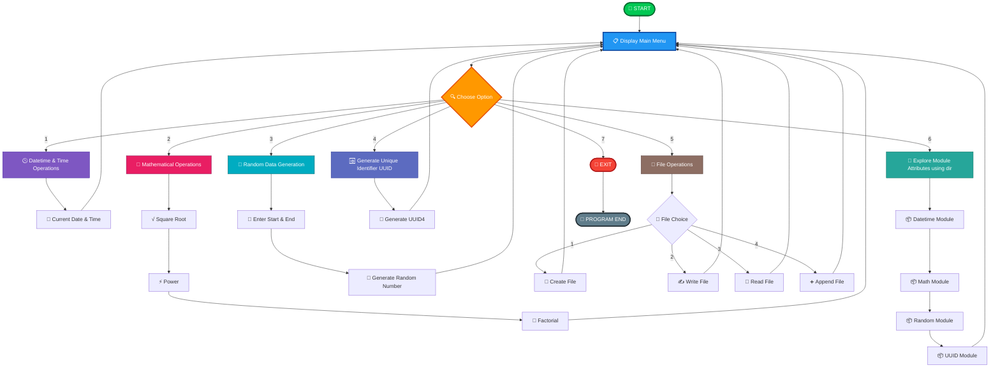
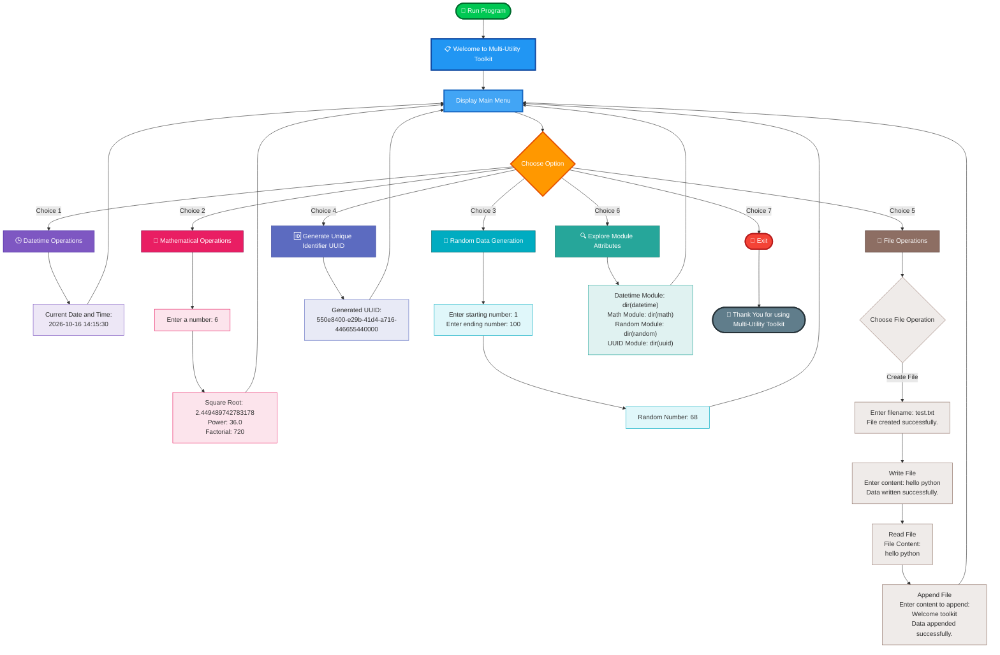

# 📦 ✦ **MODULER-PACKAGER** ✦ ⚙️

### 🐍 `MODULES` • `PACKAGES` • `BUILT-IN LIBRARIES`

[](https://www.python.org/)
[](#)
[](#)
[](#)

<br>


<br>

`⚡ Python` • `🧩 Utilities` • `📁 File Handling` • `🆔 UUID` • `🎲 Random` • `🧮 Math`

</div>

---

## 🚀 About The Project

**Moduler-Packager** is a Python-based **Multi-Utility Toolkit** created to demonstrate the practical use of Python modules, packages, built-in libraries, custom modules, and file handling.

It provides an interactive **menu-driven interface** where different utilities can be accessed from a single program.

---

## ✨ Features

| 🔢 | Feature |
|:---:|---|
| 🕒 | Datetime & Time Operations |
| 🧮 | Mathematical Operations |
| 🎲 | Random Data Generation |
| 🆔 | UUID Generation |
| 📁 | File Operations using Custom Module |
| 🔍 | Module Attribute Exploration using `dir()` |
| 🚪 | Exit |

---

## 🛠️ Technologies & Concepts

<p align="center">


</p>

---

## 📂 Project Structure

```text
📦 Moduler-Packager
│
├── 🐍 main.py
├── 📅 datetime_utils.py
├── 🧮 math_utils.py
├── 🎲 random_utils.py
├── 🆔 uuid_utils.py
│
└── 📁 utilities
    ├── 📦 __init__.py
    ├── 📄 file_operations.py
    └── 🧮 math_operations.py
```

## 📊 PROGRAM FLOW




## 📤 SAMPLE OUTPUT




## 🧠 CONCEPTS DEMONSTRATED

| Concept | Purpose |
|---|---|
| 📦 Modules | Use built-in and custom Python modules |
| 📁 Packages | Organize modules inside the `utilities` package |
| ⚙️ Functions | Create reusable program operations |
| 🔀 Conditional Statements | Handle different menu choices |
| 🔁 Loops | Keep the menu running until Exit |
| 📄 File Handling | Create, write, read and append files |
| 🎲 Random Module | Generate random numbers |
| 🆔 UUID Module | Generate unique identifiers |
| 🕒 Datetime Module | Work with date and time |
| 🧮 Math Module | Perform mathematical calculations |
| 🔍 `dir()` | Explore module attributes |
| 🖥️ Menu-Driven Program | Provide an interactive user interface |

    

    

    

## 📸 SCREENSHOTS & 🎥 DEMO VIDEO

### 📸 Project Screenshots


### 🎥 Demo Video


## 👩‍💻 AUTHOR

<div align="center">

### ✨ Khushi Chaudhary ✨

🐍 Python Developer | 📦 Module & Package Explorer

**Project:** `Moduler-Packager`

</div>

---

## 🌟 THANK YOU

<div align="center">

### 💙 Thank you for visiting my project!

⭐ If you found this project useful, consider giving it a **Star**!

🐍 **Built with Python**  
📦 **Modules • Packages • Functions • File Handling**

<br>


</div>


    
